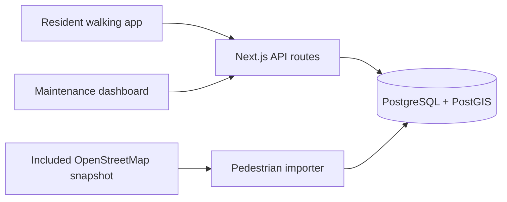

# TownshipGo

A pedestrian walking planner and footpath maintenance dashboard. Residents can choose personal walking requirements, plan around checked rest facilities and destination entrances, discover reachable places, and report path problems. Dated verification records explain which conditions are checked and which still need confirmation.

The app now runs on **Next.js → API routes → PostgreSQL/PostGIS**. It uses free, open-source software and the included OpenStreetMap snapshot. No hosted database account, API key or database subscription is required for local development.

The planner covers **Pasar Seni–Chinatown–Masjid Jamek**, **Universiti Malaya campus** and the **Elmina bridges**. The central KL snapshot includes 5,142 pedestrian segments and district population context. The UM snapshot includes 2,513 segments, including 479 with recorded roof cover. See [Pasar Seni pilot setup](docs/pasar-seni-pilot.md) and [UM data sources](data/um-campus/README.md).

The two KL pilots include dated Rapid KL timetable stops, additional access and facility details, and time-of-day shade estimates. Pasar Seni MRT has named street-level gates. The resident panel also shows official MET Malaysia warnings and current recorded walkway, entrance or lift disruptions. See [walking details and source updates](docs/pilot-walking-details.md).

The resident map opens in 3D with named streets and landmarks. Choose **2D map** in the map view menu for the OpenStreetMap street style. Use **From** to pick a mapped starting point or your location, then search for a destination. On a phone, tap or drag the panel handle to expand the tools and bring back the map. The rain-shelter option favours mapped roof cover on routes where that data is available. The weather cards show current temperature and the next five hourly rain forecasts from [Open-Meteo](https://open-meteo.com/en/docs).

The shared [pedestrian world model](docs/pedestrian-digital-twin.md) procedurally renders mapped walking infrastructure in both map modes, offers level selection, uses the same source-qualified shapes for shadow estimates, and exports real-world survey gaps. The operator can simulate proposed pedestrian links, roof covers, trees and rest locations. See the source status and optional free Overture/Google/Meta-WRI import commands in that guide. The normal app does not require external GIS downloads at runtime.

The public GitHub Pages site is an **interactive preview** of the walking planner, built from the included OSM snapshot. Map combines place search, nearby facilities and route planning. Walk appears when you start a route, and Saved holds walk history and offline packs. Reports and shortcut drafts are saved on the device in the preview. The full server version handles shared maintenance reports and shortcut review. [Public preview](https://roshanm75.github.io/Township_Test/) [Everyday walking tools](docs/everyday-walking-tools.md)

To build and test the public version without a database:

```bash
npm ci
npm run build:pages
npm run preview:pages
```

The Pages build generates actual HTML/CSS/JavaScript in `out/`, with the `/Township_Test/` prefix and public source data. It never reads or exports the local database, or depends on live data-download services during CI. Pasar Seni opens by default. The area selector offers UM and Elmina. Use `npm run data:rebuild` for Pasar Seni or `npm run data:rebuild:um` for UM to rebuild from the committed archives. Missing source data leaves the corresponding pilot pending. Invalid source bundles stop the build. `npm run build` continues to build the full server application.

## Local setup

Prerequisites: **Node.js 24 LTS** (`nvm use`), npm, and Docker with Docker Compose. Node.js 22.18 or later is the minimum for the test runner.

```bash
npm ci
npm run db:up
npm run db:setup
npm run dev
```

- `/` — app entry page
- `/resident` — pedestrian walking planner, with `?area=um-campus` for the campus pilot
- `/dashboard` — shared maintenance queue
- `/verification` — review community routes and record dated checks for mapped places, entrances and facilities
- `/api/health` — database, PostGIS version and graph counts

`db:up` starts PostgreSQL 17/PostGIS 3.5, bound to the local loopback interface. `db:setup` creates the schema and imports the Elmina, Pasar Seni and UM pedestrian snapshots. APIs for a pilot without an imported dataset return a source availability error. A first setup needs Internet access to download packages, source data and the database image. Subsequent route planning and reports use the local database.

For a one-command startup after installation, use `npm run dev:local`. To stop the database, run `npm run db:down`; its Docker volume retains the data.

For an existing local installation, run `npm run db:setup` after updating the code. The additive schema creates the walking-asset and verification tables and preserves the existing graph, reports and observation history. It seeds mapped bridge access points, without inventing surveys or seating.

## Walking planner

- **Personal requirements:** pace, slope limit, step-free access, marked/controlled crossings, surface condition, total trip budget and optional current-check-only routing. Preferences are saved on the device and included in shared walk links.
- **Rest-aware paths:** a required rest interval changes the actual route. Only facilities with current checks for availability, path connection and seating (or wheelchair rest space) fulfil it. Optional backrest, armrest and shelter requirements are enforced. Walking to/from the seat, crossing waits and rest duration count toward the trip budget.
- **Usable arrival points:** destinations have separate entrances. Automatic selection prefers a currently checked entrance within the budget; residents can also choose one explicitly. Known closures and incompatible step-free access are rejected, with opening hours evaluated at arrival.
- **Reachable places:** “Find nearby places” uses the same network, requirements, entrances and budget for healthcare, food, shops, community places, parks, transit, toilets and water. Place cards show the arrival point, hours at the estimated arrival time, and nearby mapped seats or toilets. Public directory facts carry a source link.
- **Departure-time comfort:** Malaysia departure time selects the shade/lighting model and matching hourly weather forecast. Forecast outages or missing hours stay unavailable; no temperatures are fabricated.

The route summary includes a **red/yellow/green bar**, a text label and an icon. Green means the route meets the selected requirements and relevant current checks. Yellow means a route is available but some conditions need confirmation, including when it is the best available option. Red means no matching route was found; requirements are never silently relaxed. The bar expresses evidence and personal suitability, not a probability of safety.

See the [walking planner and verification guide](docs/walking-planner.md) for audit steps, the record model, confidence rules and estimation limits. The default pilot contains mapped access points, **no invented verified rests and no fabricated audit records**. Unknown conditions normally produce yellow routes. Add genuine observations in `/verification`, then use “Leave now” to refresh the planner.

The [team design direction](docs/team-design-direction.md) maps the environmental-routing and community ideas to the UI and future data work. The planner provides information layers with explicit unknown/expired states and a dimensional comfort breakdown; the source snapshot currently has no shade, cover or lighting observations. Satellite canopy analysis, live radar, shared voting and automatic contact alerts require additional data or backend work.

### Community routes and maintenance

- Residents can add map waypoints, record a walk, or use an earlier GPS recording. The editor previews the selected public segment and lets them trim both ends. Shared submissions enter the review queue for their area. Time-stamped GPS fixes stay on the device.
- In `/verification`, a reviewer can publish a screened suggestion, then record an in-person check and public access hours. A current field check lets walkers plan the shared route with their own requirements, rest intervals, and current hazards. Proposals with gaps stay in the review queue for mapping.
- Residents can report paths, crossings, lift outages, unavailable facilities and incorrect place details. In `/dashboard`, a reviewer records the responsible team and what they checked, then marks the repair fixed after confirming it. The resident report history shows each date. Checked outages can change the available routes, and affected active and saved walks show an update.
- GitHub Pages includes the place data, route editor and device drafts. Sharing, review and live maintenance require the Next.js server and PostGIS.

### Operator workspace

Open `/dashboard`, select the pilot and enter the reviewer key.

- **Maintenance queue** lists open cases by severity, overdue work, related reports and waiting time. An operator can assign a team, record a due date and link an existing work order. The assignment history records each handoff. Residents see the responsible team and report status.
- **Access and responsibility** shows mapped paths and facilities with incomplete, expired or upcoming checks. Search by name, team or map ID, select the target and record its responsible team with an asset-register or handover reference. New reports on the exact target inherit that team. Use the target’s verification link to record field observations.
- **Activity and exports** tracks reported, checked, fixed and dismissed events over 7, 30 or 90 days. It shows median time from report to check or fix, the current workload by team, and repeat reports on the same target. Each event counts in the period when it occurred. Access coverage counts the latest, current evidence for each checklist field, including confirmed barriers.

CSV, GeoJSON and JSON downloads are available for cases and access checks. Case downloads include open cases and events in the selected period. Check downloads cover the pilot inventory as of export time. Integration clients use `GET /api/operator/activity` and `GET /api/operator/export?area=pasar-seni&dataset=cases&format=json&days=30` with the server reviewer key as a Bearer token. Use `dataset=checks` for the access inventory. The machine-readable exports include a schema version, the pilot and the map revision. Free-text report and audit notes stay outside these downloads.

Run `npm run db:setup` to apply the operator tables to an existing server. GitHub Pages still serves the public pilot maps and source data. Live assignments, reporting history, and operator exports use PostGIS.

### Database configuration

The app and setup scripts default to the development database created by Compose. Copy `.env.example` to `.env.local` to set `TOWNSHIP_REVIEW_KEY` or override `DATABASE_URL`. Both values stay on the Next.js server. Enter the reviewer key in the maintenance or verification page to enable review actions in that tab.

The default password in Compose is for local development. If you customize the database user/password/port, keep your Compose settings and `DATABASE_URL` consistent. Restart Next.js after changing the connection string. Docker Compose reads exported variables or `.env`; the Node scripts also read `.env.local`.

The schema update adds the review records to the database selected by `DATABASE_URL`. The reviewer key provides shared pilot-team access. An operator deployment can replace it with individual accounts and area-level roles.

## Pedestrian data

The **Elmina example** contains **547 nodes and 602 pedestrian edges**, including 35 mapped crossings, from the supplied OpenStreetMap snapshot. Pasar Seni and UM have separate source bundles and identifiers. All three route graphs use dedicated pedestrian paths and ways with compatible foot access. Shared cycleways, service paths and tracks require explicit public foot access.

Sample start and destinations match the Elmina snapshot: Jambatan Pelangi Elmina and the Iconic Bridge of Elmina City are both reachable on its pedestrian network. Area boundaries and starting locations live in `lib/pilots.ts`. The Pasar Seni and UM importers derive connected places and a starting point from their source networks. The planner reports no route when a chosen location is outside the mapped network or disconnected.

Unknown shade, lighting and accessibility attributes remain unknown; routing assumptions are not field observations. See [data sources and import rules](docs/data-sources.md) for provenance, attribution and limitations.

To import a different Overpass JSON snapshot into a **separate empty database**:

```bash
npm run db:migrate
npm run db:seed -- --source /path/to/overpass.json
```

Set `DATABASE_URL` to that database first. Repeating setup with the same graph preserves existing reports and audits. The importer refuses a different graph in a populated database because regenerated edge identifiers could otherwise misattach reports. The original `graph.json`, `graph.sql`, shapefiles and GeoJSON are retained as reference assets; normal setup uses the strict pedestrian import from `precinct.json` instead.

## How data flows



- `GET /api/graph` returns the pedestrian graph with PostGIS geometry and attribution.
- `GET /api/pilot-context?area=pasar-seni` returns source coverage, local transit, district/demand context and GIS metadata. Other read APIs accept the same area parameter; legacy unscoped calls retain Elmina.
- `GET /api/hazards` returns open routing hazards.
- `GET /api/walking-data` returns mapped assets, path anchors and verification history.
- `POST /api/assets` adds an unverified mapped place, entrance or facility.
- `POST /api/verifications` appends a validated observation to a path, crossing, entrance or facility.
- `GET /api/reports?status=open` returns the maintenance queue; `status=all` includes fixed reports.
- `POST /api/reports` creates a report from `{ lat, lng, kind, description?, edge_id?, reported_by_proxy? }`.
- `POST /api/reports/:id/fix` marks the report and its linked hazard fixed.

PostGIS verifies that reports are within 150 metres of a mapped pedestrian path. The server derives the category, severity and cost estimate. Creating a report writes both records in one transaction; marking it fixed updates both in one transaction. Fixing one report leaves other open reports on the same edge intact.

The dashboard starts empty. It no longer substitutes invented maintenance reports when the database is empty or unavailable.

## Checks and production startup

```bash
npm run lint
npm run typecheck
npm test
npm run build
npm run test:integration
npm start
```

Unit tests cover pedestrian filtering, report validation, shared links, evidence expiry, actual rest detours, entrance availability, strict requirements, budgets, reachable places and forecast handling. Integration tests start the built Next.js server against a temporary real PostgreSQL/PostGIS database, exercise report creation/fixing, asset anchoring, verification history, spatial checks, SQL parameter handling, rollback, concurrent requests and outages, then remove only that test database. They require the local database to be running and a role allowed to create test databases; the Compose development role supports this.

CI uses a PostGIS service and runs setup, lint, type checking, unit tests, build and integration tests. The full shared app requires a Next.js server runtime because its APIs access PostgreSQL. A separate Pages workflow builds and deploys the interactive snapshot preview; it cannot host those APIs or a database.

## Free supporting services and data

- **PostgreSQL/PostGIS:** local storage and spatial queries, with no hosted database subscription.
- **OpenStreetMap:** the included dataset and the map's public tile layer, with contributor attribution. Public tiles follow the provider's usage policy; no bulk downloads or offline tile scraping are performed.
- **Open-Meteo:** optional hourly weather forecasts. The weather endpoint explicitly reports unavailable data during an outage; path-based comfort estimates remain available.
- **Geist:** bundled fonts; builds do not download Google Fonts.

Restricted environments need package-registry/container-registry access for installation, `api.open-meteo.com` for live weather and `*.tile.openstreetmap.org` for map tiles. The walking graph and report storage do not depend on those public services after local setup.

## Local database backup

Reports persist in the `townshipgo_township_postgres` Docker volume across container restarts. Cloud task snapshots may not retain Docker-managed volumes; back up data you want to carry to another machine before replacing the environment:

```bash
mkdir -p .local/backups
docker compose exec -T db pg_dump -U township -d township > .local/backups/township.sql
```

The `.local` directory is ignored by Git. Store backups separately when you need durable retention. Restore a dump into a separate empty database, rather than overwriting a database with reports you want to keep.
